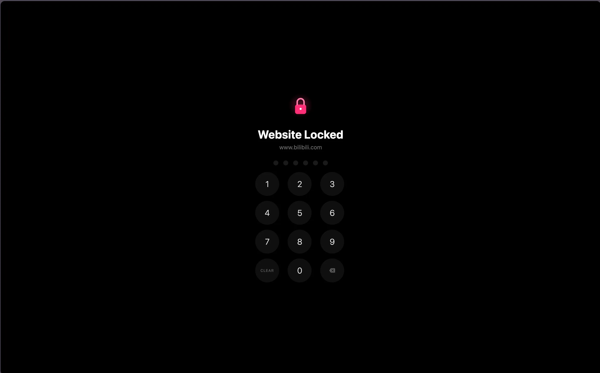
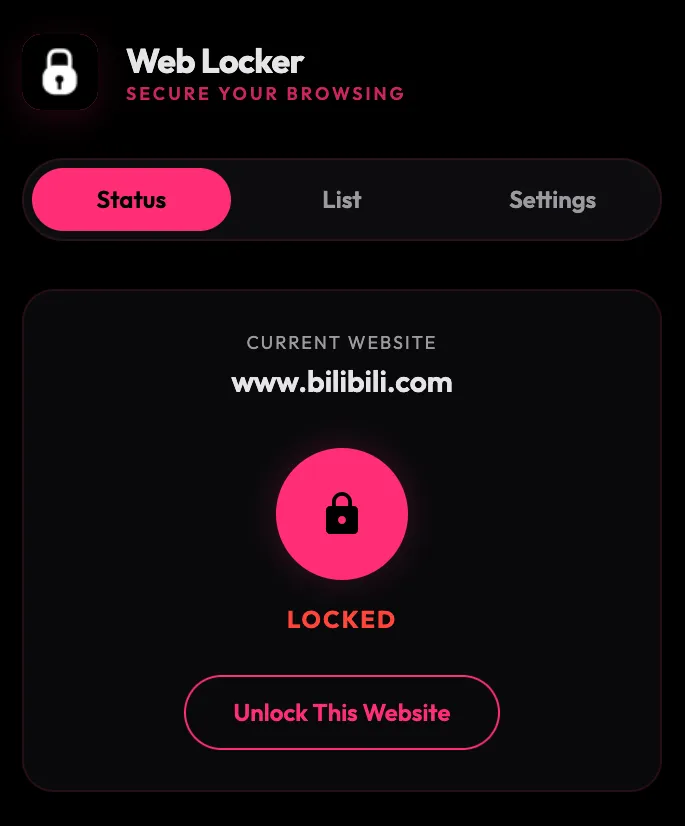
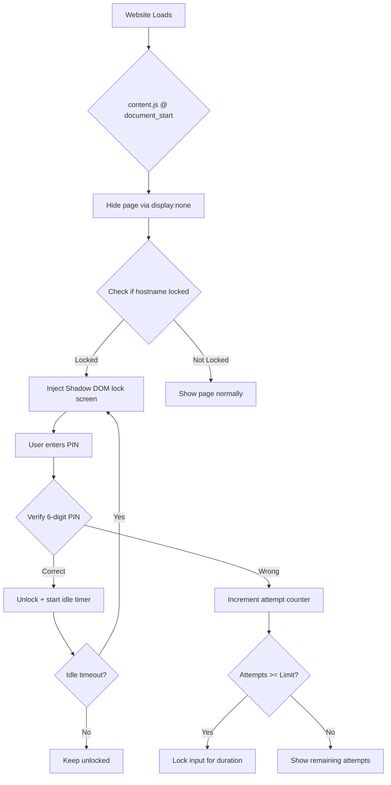

# Web Locker

```
 ██╗    ██╗███████╗██████╗ ██╗     ██████╗ 
 ██║    ██║██╔════╝██╔══██╗██║     ██╔══██╗
 ██║ █╗ ██║█████╗  ██████╔╝██║     ██║  ██║
 ██║███╗██║██╔══╝  ██╔══██╗██║     ██║  ██║
 ╚███╔███╔╝███████╗██████╔╝███████╗██████╔╝
  ╚══╝╚══╝ ╚══════╝╚═════╝ ╚══════╝╚═════╝ 

 PIN Lock | Auto Re-Lock | Lockout Protection
```

[](./LICENSE)


> A minimalist browser extension that locks distracting websites behind a 6-digit PIN. Zero content leaks, zero tracking — just pure focus.

---

## Preview

| Lock Screen | Popup Menu |
|:---:|:---:|
|  |  |

---

## Features

- **6-Digit PIN Lock** — Lock any website by domain. All subdomains are protected.
- **Auto Re-Lock** — Automatically re-locks websites after idle. Configurable timer.
- **Lockout Protection** — Too many wrong attempts? Input locks temporarily.
- **Numpad + Keyboard** — Click digits or type directly. Backspace + Escape.
- **Zero Content Leak** — Page hidden before rendering. No flashing, no peeking.
- **Import / Export** — Backup and migrate your lock list. No account needed.
- **Cross-Browser** — Chrome, Edge, Firefox. Single Manifest V3.
- **Lockout PIN Confirmation** — Changing lockout settings requires PIN.

---

## How it works

> [!NOTE]
> **Web Locker Architecture**
>
> 1. `content.js` runs at `document_start` and hides the whole page before anything renders.
> 2. Content script checks with the background script whether the hostname is locked.
> 3. If locked, a Shadow DOM lock screen (logo + PIN pad) is injected.
> 4. Each digit posts to `chrome.storage.local`. On 6-digit match, the site unlocks.
> 5. After idle timeout, the lock screen re-appears automatically.

Unlock state is kept in-memory per tab — nothing sensitive is cached across tabs or restarts.

---

## Installation

Web Locker ships a **single cross-browser `manifest.json`** and runs on Chrome, Edge, and Firefox.

### Chrome / Edge

1. Download or clone this repository
2. Go to `chrome://extensions/`
3. Enable **Developer mode** in the top right corner
4. Click **Load unpacked** and select this extension folder
5. Pin the icon, set your PIN, and start locking websites!

### Firefox

1. Download or clone this repository
2. Open Firefox and go to `about:debugging`
3. Click **This Firefox**
4. Click **Load Temporary Add-on** and select the `manifest.json` file

---

## Usage

1. Click the **Web Locker** icon in your browser toolbar
2. On a website you want to lock, click **Lock Website**
3. Reload the page — the lock screen appears
4. Enter your **6-digit PIN** to unlock
5. The site re-locks after your configured idle time

### Popup Tabs

| Tab | Purpose |
|-----|---------|
| **Lock** | Lock/unlock current website, see status |
| **List** | Add/remove locked domains |
| **Settings** | Change PIN, auto-lock timer, lockout settings |
| **Import / Export** | Backup or restore your lock list |

---

## Security

> [!IMPORTANT]
> **Privacy First**
>
> - The PIN is stored in `chrome.storage.local` on your device only.
> - There is **no backend or remote server**. All verification happens locally.
> - **No telemetry, analytics, or usage data** is collected.
> - Lockout state persists across browser restarts.
> - Import / Export files contain only your lock list.

See [`PRIVACY_POLICY.md`](./PRIVACY_POLICY.md) for the full data-handling statement.

---

## Technical Details



**Key files:**

| File | Purpose |
|------|---------|
| `manifest.json` | Extension configuration (MV3) |
| `content.js` | Page hiding + lock screen injection |
| `popup.js` | Popup UI logic, PIN verification, settings |
| `background.js` | Event routing, tab management, lock state |

---

## What's Next

> [!TIP]
> Future development plans:
>
> - Publishing to **Chrome Web Store** & **Firefox Add-ons**
> - Custom lock screen messages per website
> - Scheduled locking (lock sites during work hours)
> - Statistics dashboard (time spent on locked sites)

---

## Contributing

Contributions are welcome! Feel free to:

1. Fork this repository
2. Create a feature branch
3. Submit a pull request

---

## License

MIT License — free to use in your own projects!

---

<div align="center">
Made with care
<br>
Star us if you find this useful!
</div>