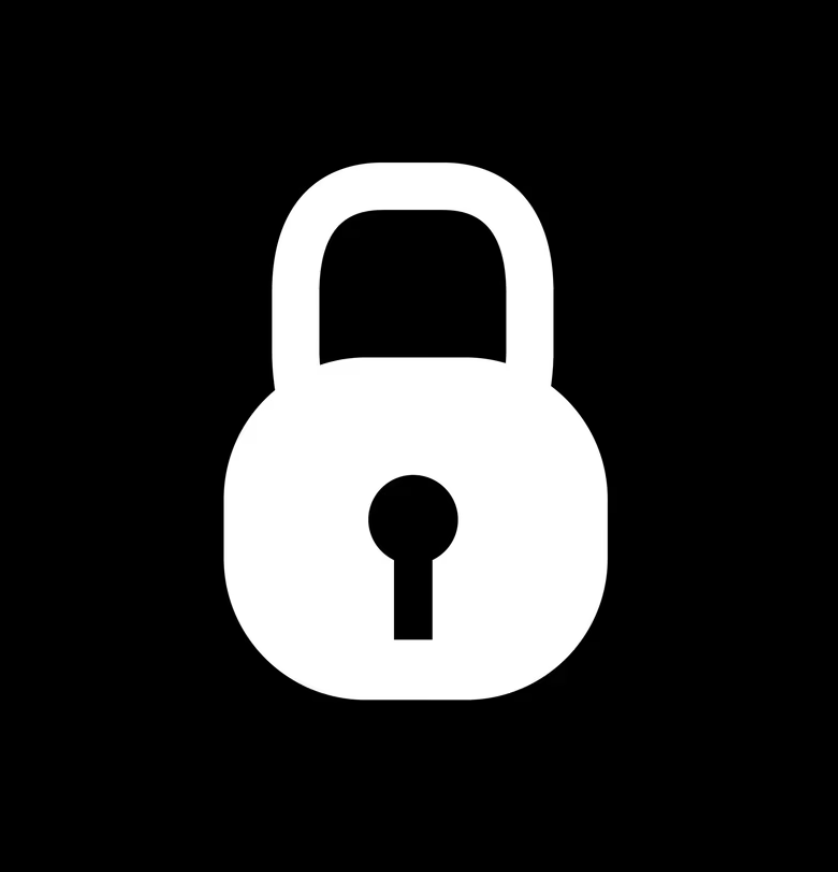

# 🔒 Web Locker

A browser extension that locks specific websites behind a 6-digit PIN (or password). A lightweight focus/anti-procrastination tool — set a PIN, choose which sites to protect, and the page is completely hidden until the correct PIN is entered.

Supports **Chrome, Edge, and Firefox** through a single cross-browser [Manifest V3](https://developer.mozilla.org/en-US/docs/Mozilla/Add-ons/WebExtensions/manifest.json) file.

---

## ✨ Features

- **Lock any website per-domain** — lock a site and all of its subdomains are protected.
- **6-digit PIN** — secure your locked sites with a numeric PIN.
- **Auto-lock on idle** — automatically re-lock after inactivity. Configurable intervals:
  - **Instant** — locks again on every reload / new tab,
  - 1 Minute / 5 Minutes / 15 Minutes / 30 Minutes.
- **Zero content leak** — the page is hidden (`display:none`) *immediately* when the page starts loading, before any content is painted. The lock screen (logo + PIN pad) is then injected, so protected content is never visible without the correct PIN.
- **Keyboard support** — type digits / `Backspace` / `Escape` (clear).
- **Dark aesthetic** — clean, distraction-free lock screen.

---

## ⚙️ How it works

1. **Instant page hide** — `content.js` runs at `document_start` (top frame only) and hides the whole page (`html { display: none }`) before anything renders.
2. **Lock check** — the content script asks the (event-page) background script whether the current hostname is locked in `chrome.storage`.
3. **Lock screen** — if locked, a Shadow DOM lock screen (logo + PIN pad) is injected over the page.
4. **PIN verify** — each PIN digit posts to `chrome.storage.local`; on a full 6-digit match it unlocks the site **for this tab only** for the configured auto-lock timeout (or until idle lock triggers).
5. **Idle lock** — activity listeners (mousemove / keydown / click / scroll) reset a timer; once idle past the timeout, the lock screen is re-shown for that tab.

Unlock state is kept in-memory per tab (cleared on tab close) — nothing sensitive is cached across tabs or restarts.

---

## 🔐 Security notes

- The PIN is stored in **browser storage** (`chrome.storage`) as set by you. Treat it like any local browser setting — it is **not** server-side and is synced only across **your own** signed-in browser (if you use sync storage).
- There is no backend or remote server. All verification happens locally, inside the extension.
- No telemetry, analytics, or usage data is collected.

See [`PRIVACY_POLICY.md`](./PRIVACY_POLICY.md) for the full data-handling statement (subtitle translation data etc. applies to *my other* BiliSub extension; Web Locker itself collects nothing).

---

## 🚀 Installation

> One `manifest.json` works everywhere. Requires Chrome 111+ / Edge 111+, or Firefox 142+ (Firefox uses a background event page, so the `service_worker` key is ignored by Firefox and the `scripts` key provides the background).

### Chrome / Edge

1. Download or clone this repository.
2. Open `chrome://extensions/`.
3. Enable **Developer mode** (top-right).
4. Click **Load unpacked** and select this folder.
5. Pin the icon, set a PIN, and add sites to lock.

### Firefox

1. Download or clone this repository.
2. Open `about:debugging` → **This Firefox**.
3. Click **Load Temporary Add-on** and select `manifest.json`.

---

## 🎮 Usage

1. Click the **Web Locker** toolbar icon.
2. Set your **6-digit PIN** (initial setup screen appears on first run).
3. While on a site you want to protect, click **Kunci Website Ini** (lock this site).
4. Reload the page — the page is hidden until you enter the PIN.

### Settings

- **Daftar** tab — add/remove locked domains (e.g. `facebook.com`).
- **Pengaturan** tab — change your PIN and pick the **Auto Lock** idle timeout.

---

## 📦 Permissions

| Permission | Why |
|---|---|
| `storage` | Save the PIN, locked-site list, and auto-lock timeout. |
| `tabs` & `activeTab` | Detect the active tab's URL, (un)lock per-tab, and reload tabs. |
| `<all_urls>` (host) | Run the page-hiding content script on every site. |

---

## 🛠 Development / Build

No build step. The extension is plain JS + an inline Shadow DOM lock screen. To inspect:

- **Popup** — inspect via the extension popup (`about:debugging` → inspect).
- **Content script** — open the protected page's devtools; the lock screen lives under `#web-locker-root` (Shadow DOM, open mode).

---

## 🤝 Credits

Built as a compact, privacy-first site-locker. The lock screen uses a self-contained SVG/embedded style approach with no external network requests, so it works even on strict-CSP pages.

## 📝 License

See [`LICENSE`](./LICENSE) (if not present, this project is released for personal use). Feel free to fork and adapt.

---

Made with care. 🫡

